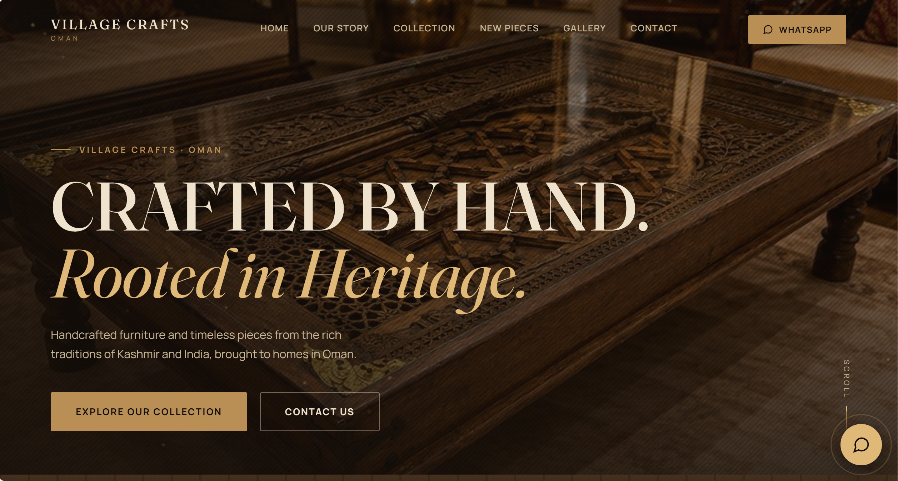
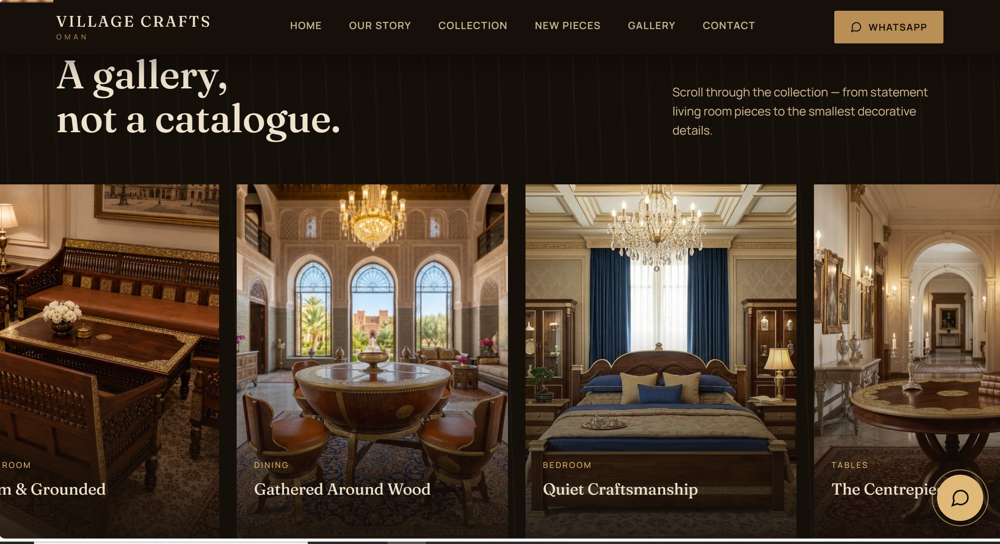

# Village Crafts — Website Design & Performance Study

A story-driven digital showroom for Village Crafts, a Muscat-based business offering handcrafted furniture inspired by Jodhpur and traditional shawls from Kashmir and Srinagar.

**Live Website:** [villagecrafts.shop](https://villagecrafts.shop/)  
**GitHub Repository:** [village-crafts-website-performance](https://github.com/hxxns-code/village-crafts-website-performance)

---

## 1. Project Overview

Village Crafts needed a digital presence that reflected the character, craftsmanship, and cultural heritage behind its products.

The goal was to create more than a conventional product catalogue: a digital showroom where visitors could explore the brand's story, browse collections, view product imagery, and enquire directly through WhatsApp.

I contributed to the design direction, content, asset selection, client coordination, domain and deployment setup, and testing. AI-assisted development tools were used extensively to generate and refine the website code.

### Project Objectives

- Build a visually distinctive website that communicates craftsmanship and heritage.
- Create a consistent experience across desktop and mobile devices.
- Make product discovery and customer enquiries straightforward.
- Deploy the website using a custom domain and Cloudflare.
- Investigate website performance and experiment with HTML optimisation on a separate local copy.

## 2. Website Preview

Explore the website by clicking either screenshot or the links beneath it.

### Homepage

[](https://villagecrafts.shop/)

[**Visit the live homepage →**](https://villagecrafts.shop/)

### Collection

[](https://villagecrafts.shop/collection.html)

[**Explore the live collection →**](https://villagecrafts.shop/collection.html)

---

## 3. Design & User Experience

The visual direction combines traditional craft influences with a modern editorial layout.

### Visual Identity

- **Colour palette:** Cream, walnut, brass, gold, and oxblood tones.
- **Visual details:** Textures, decorative paisley-inspired dividers, and refined typography.
- **Motion:** Subtle animations and scroll-based visual effects.
- **Responsive design:** Layouts designed to adapt to different screen sizes.

### Website Pages

The website is organised into six HTML pages:

| Page | Purpose |
|---|---|
| Homepage | Introduces the brand and guides visitors through the showroom. |
| Our Story | Communicates the brand's identity and craftsmanship. |
| Collection | Presents the product collection. |
| New Pieces | Highlights selected pieces and newer additions. |
| Gallery | Provides a visual browsing experience with a lightbox. |
| Contact | Helps visitors get in touch with the business. |

### Customer Enquiry Workflow

The website uses WhatsApp links to connect product discovery with direct customer enquiries.

Visitors can explore products and initiate a conversation without going through a checkout process.

**Scope:** This is a showcase and enquiry website, not a full e-commerce platform. It does not implement online payments, a shopping cart, or a backend order-management system.

---

## 4. Performance Optimisation Study

Alongside the website, I conducted a separate experiment to investigate how large HTML files affect page delivery and how restructuring the files could improve performance.

The original website contained unusually large HTML documents. I created an experimental copy and used a Python optimisation script to reduce their size.

**Important:** These optimisations were tested on a local experimental copy. They have not been presented as changes to the live website.

### HTML File Size Comparison

| HTML file | Original size | Optimised size | Reduction |
|---|---:|---:|---:|
| `index.html` | 3,938.7 KB | 66.8 KB | 98.3% |
| `collection.html` | 1,859.3 KB | 44.7 KB | 97.6% |
| `contact.html` | 616.2 KB | 73.2 KB | 88.1% |
| `gallery.html` | 3,115.2 KB | 69.5 KB | 97.8% |
| `new-pieces.html` | 6,266.8 KB | 91.8 KB | 98.5% |
| `our-story.html` | 1,079.1 KB | 43.0 KB | 96.0% |

The results show substantial reductions in the size of the HTML documents in the experimental copy.

These figures refer to **HTML file sizes only**. They do not represent the percentage reduction in total page weight, which also depends on images, stylesheets, scripts, fonts, and other resources.

### Performance Comparison

The original and experimental homepage were evaluated using Lighthouse under a simulated mobile environment.

| Metric | Original homepage | Optimised experiment |
|---|---:|---:|
| Lighthouse performance score | 53–55 | 82–86 |
| First Contentful Paint (FCP) | 21.9–23.2 s | 1.7 s |
| Largest Contentful Paint (LCP) | 23.2–23.3 s | 4.1–4.7 s |
| Cumulative Layout Shift (CLS) | 0 | 0 |
| Total Blocking Time (TBT) | 0–160 ms | 0 ms |

**Testing context:** Lighthouse 13.4.1, Moto G Power emulation, and Slow 4G simulation. The optimised results shown are from two recorded runs after an additional CSS adjustment. Lighthouse results can vary between runs, so these results should be interpreted as measurements from this experiment rather than guaranteed production performance.

### What I Investigated

- Identifying oversized HTML files.
- Reducing document size in a separate experimental copy.
- Checking local asset references and page availability.
- Measuring page performance with Lighthouse.
- Comparing browser loading metrics before and after optimisation.
- Investigating how CSS animation and initial element visibility can affect the rendering experience.

### Local Load Testing

I also used k6 to exercise selected pages served from a local Python HTTP server.

The test checked that requests returned successful HTTP responses and that response bodies were non-empty.

The test configuration used five virtual users over approximately 30 seconds. The recorded runs reported successful checks and no failed requests.

These were local tests, not a production load test. The results therefore do not establish how the website would perform under equivalent traffic on its live hosting infrastructure.

### Asset Validation

The experimental copy was checked for missing local assets. The validation covered six HTML pages and 70 local asset references.

Some embedded `data:image/` references remained outside the scope of the completed investigation. The validation should not be interpreted as a complete audit of every possible browser rendering issue.

---

## 5. Technology & Tools

| Technology or tool | Purpose |
|---|---|
| HTML | Website page structure |
| CSS | Layout, styling, responsive design, and animations |
| JavaScript | Interactive website features |
| WhatsApp links | Direct customer enquiries |
| Cloudflare | Domain DNS and website deployment |
| Python | Local development and HTML optimisation experiments |
| k6 | Local HTTP load testing |
| Lighthouse | Browser performance evaluation |
| Git and GitHub | Version control and project documentation |
| AI-assisted development tools | Code generation, iteration, and debugging assistance |

The exact tools used for code generation were part of an AI-assisted development workflow. The project documentation distinguishes that workflow from my contributions to the design, content, deployment, and evaluation.

---

## 6. Repository Structure

```text
village-crafts-website-performance/
├── README.md
├── .gitignore
├── screenshots/
│   ├── homepage.png
│   ├── collection.png
│   └── performance-comparison.svg
└── performance/
    ├── scripts/
    │   ├── optimize_village_site.py
    │   └── site-load-test.js
    └── results/
        ├── html-size-comparison.csv
        ├── local-k6-run.txt
        ├── local-k6-summary.json
        └── performance-test-report.md
```

This is the intended structure of the project repository. File availability depends on what has actually been committed to the `main` branch.

The original website files and the experimental optimised copy are maintained separately and are not necessarily included in this repository.

---

## 7. Running the Experiments Locally

The following steps describe the general workflow. Run them from the project directory after obtaining the repository and the corresponding website files.

### Start a local HTTP server

From the directory containing the HTML files:

```bash
python -m http.server 8000
```

Open `http://localhost:8000/` in your browser.

### Run the k6 test

With k6 installed and the local server running, execute the load-test script from the repository root:

```bash
k6 run performance/scripts/site-load-test.js
```

Check the script's configured URLs and port before running it. The script must target the local server you started.

### Run Lighthouse

Use Chrome DevTools or Lighthouse to test the local homepage. Keep the device emulation and network throttling consistent when comparing results.

### Review the optimisation results

See the `performance/results/` directory for the recorded report, CSV comparison, and test outputs that have been committed.

---

## 8. Deployment

The live website is available at:

**[https://villagecrafts.shop/](https://villagecrafts.shop/)**

The project uses a custom domain configured through Cloudflare. The website was deployed as a static website, without a custom application backend.

The performance experiment was kept separate from the live website so that optimisation work could be evaluated without unintentionally changing the client's production site.

---

## 9. Key Learnings

This project provided practical experience in:

- Translating a client's brand identity into a digital experience.
- Planning multi-page website navigation and customer journeys.
- Working with responsive layouts, visual assets, and interactive elements.
- Configuring a custom domain and DNS for deployment.
- Using GitHub to document a project and its experiments.
- Measuring performance with Lighthouse and k6.
- Distinguishing document-size improvements from overall page-load improvements.
- Using AI-assisted development tools while reviewing and testing their output.

The performance work reinforced an important lesson: optimisation claims need to be supported by clearly documented test conditions, reproducible measurements, and an honest distinction between local experiments and production results.

---

## 10. Future Improvements

Potential next steps include:

- Optimising and serving images in appropriate modern formats.
- Reviewing image dimensions and lazy-loading behaviour.
- Investigating remaining embedded image data.
- Improving accessibility and keyboard navigation.
- Testing performance on the deployed website under controlled conditions.
- Repeating Lighthouse tests and reporting median results.
- Expanding load tests to cover additional routes and realistic user journeys.
- Considering a maintainable content-management workflow if the business grows.

---

## 11. Credits

Created for **Village Crafts**, a Muscat-based business celebrating handcrafted furniture and traditional textiles.

The project was developed through a combination of personal design and project work, client feedback, and AI-assisted code generation.

**Live website:** [villagecrafts.shop](https://villagecrafts.shop/)  
**Project repository:** [GitHub](https://github.com/hxxns-code/village-crafts-website-performance)

